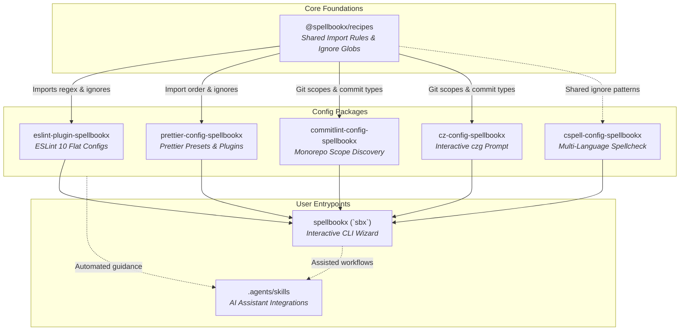

# Spellbookx Architecture

## 1. Executive Summary & Philosophy

**Spellbookx** is a modular, high-performance monorepo providing composable, production-ready developer toolchain configurations for modern JavaScript, TypeScript, React, Astro, Svelte, and Node.js environments.

The project is guided by four foundational architectural principles:

1. **Native Modern Standards First**: Exclusively target modern web and tooling standards—ESLint 10 Flat Configs, pure ECMAScript Modules (`"type": "module"`), TypeScript strict mode targeting `ES2024`, and native Node.js / pnpm workflows without legacy wrappers or polyfills.
2. **Single Source of Truth (SSOT)**: Shareable primitives, such as import order groupings, ignore globs, and framework definitions, are centralized in `@spellbookx/recipes` and reused uniformly across ESLint, Prettier, and CSpell.
3. **Strict Dogfooding**: The monorepo uses its own configuration packages (`eslint-plugin-spellbookx`, `prettier-config-spellbookx`, `commitlint-config-spellbookx`, `cz-config-spellbookx`, `cspell-config-spellbookx`) across all its source code, root configs, and sub-packages.
4. **Infinite Composability & Zero Friction**: Every preset can be used out-of-the-box with a one-line import, or composed and customized via helper functions like `defineSbxConfig`.

---

## 2. Monorepo Structure & Package Topology

The repository is organized as a pnpm `12.x` workspace running on Node.js `26.x` and orchestrated by **Turborepo** for build caching and topological pipeline execution.

```text
spellbookx/
├── .agents/skills/                   # AI coding assistant skills for Spellbookx tools
├── .changeset/                       # Changesets configuration & lockstep release notes
├── .config/                          # Tool configs without `.config.` in the file name
│   ├── cspell/
│   │   └── custom.txt                # Project-specific CSpell word list
│   ├── cspell.yml                    # CSpell configuration
│   ├── dropdx.config.json            # Automated release configuration
│   └── lefthook.yml                  # Lefthook Git hook definitions
├── .github/
│   ├── ISSUE_TEMPLATE/               # Bug report and feature request forms
│   ├── dependabot.yml                # Weekly dependency and GitHub Actions updates
│   ├── PULL_REQUEST_TEMPLATE.md      # Pull request checklist template
│   └── workflows/                    # CI checks and scheduled maintenance workflows
├── .vscode/                          # Recommended VS Code extensions and workspace settings
├── docs/
│   ├── CONTRIBUTING.md               # Main contributing guide
│   ├── SECURITY.md                   # Security policy and vulnerability reporting
│   └── contribute/                   # Detailed contributor documentation
├── images/                           # README banner and brand assets
├── packages/
│   ├── commitlint-config-spellbookx/ # Conventional Commits rules and monorepo scope discovery
│   ├── cspell-config-spellbookx/     # Multi-language & technical spellcheck configuration
│   ├── cz-config-spellbookx/         # czg interactive commit prompt configuration
│   ├── eslint-plugin-spellbookx/     # ESLint 10 Flat Config plugin with 17 modular presets
│   ├── prettier-config-spellbookx/   # Prettier presets, plugins & defineSbxConfig composer
│   ├── recipes/                      # Core shared recipes (import regexes, ignores & git scopes)
│   └── spellbookx/                   # CLI wizard (`sbx`) for interactive toolchain scaffolding
├── scripts/
│   ├── update-node.ts                # Syncs `.nvmrc` and `@types/node` with Node.js LTS
│   └── update-turbo.ts               # Upgrades `turbo` and runs `@turbo/codemod`
├── .editorconfig                     # Cross-editor indentation and line-ending defaults
├── .gitattributes                    # LF line endings and binary files
├── .nvmrc                            # Pinned Node.js major version (26)
├── .prettierignore                   # Paths excluded from Prettier formatting
├── commitlint.config.mjs             # Commitlint preset configuration
├── cz.config.mjs                     # Interactive `czg` commit prompt configuration
├── eslint.config.mjs                 # ESLint flat config (`recommended-spellcheck`)
├── package.json                      # Root workspace scripts and shared devDependencies
├── pnpm-workspace.yaml               # pnpm workspace globs, build allow-list, and hoisting rules
├── prettier.config.mjs               # Prettier base preset configuration
├── tsconfig.base.json                # Shared base TypeScript compiler options
├── tsconfig.json                     # Root TypeScript configuration for `scripts/`
└── turbo.json                        # Turborepo task graph, inputs, outputs, and caching rules
```

### Configuration Placement Convention

Configuration files follow a consistent placement rule:

- **Files with `.config.` in the name** live in the **repository root**, where their CLIs discover them automatically without extra flags: [`eslint.config.mjs`](../../eslint.config.mjs), [`prettier.config.mjs`](../../prettier.config.mjs), [`commitlint.config.mjs`](../../commitlint.config.mjs), and [`cz.config.mjs`](../../cz.config.mjs).
- **Tool-name-only configuration files** live in `.config/`: [`.config/cspell.yml`](../../.config/cspell.yml) (with its dictionary at [`.config/cspell/custom.txt`](../../.config/cspell/custom.txt)), [`.config/lefthook.yml`](../../.config/lefthook.yml), and [`.config/dropdx.config.json`](../../.config/dropdx.config.json).
- **Core platform files** stay in the repository root as required by their tools: [`package.json`](../../package.json), [`pnpm-workspace.yaml`](../../pnpm-workspace.yaml), [`tsconfig.base.json`](../../tsconfig.base.json), [`tsconfig.json`](../../tsconfig.json), [`turbo.json`](../../turbo.json), [`.nvmrc`](../../.nvmrc), [`.editorconfig`](../../.editorconfig), and [`.prettierignore`](../../.prettierignore).
- **Per-package files** live inside each package directory under `packages/<name>/`: `package.json`, `tsconfig.json`, `tsconfig.build.json`, `src/`, `tests/`, `README.md`, `LICENSE`, and `CHANGELOG.md`.

### Dependency & Relationship Graph



---

## 3. Package Architecture & Deep Dives

### 3.1 `@spellbookx/recipes`

- **Role**: Foundational library providing curated constants, regex patterns, and monorepo scope discovery helpers.
- **Components**:
  - `imports`: Categorized RegExp rules for module import ordering (e.g., node built-ins, framework runtimes, component libraries, state management, utilities, internal aliases, styles).
  - `ignores`: Exhaustive ignore globs grouped by domain (Node runtime artifacts, package managers, build outputs, frameworks like Astro/Next/Svelte, test runners, operating system artifacts).
  - `git`: Shared commit types and dynamic workspace scope discovery.
- **Export Strategy**: Provides granular exports (`@spellbookx/recipes/imports`, `@spellbookx/recipes/ignores`, `@spellbookx/recipes/git`) and a root aggregator.

### 3.2 `eslint-plugin-spellbookx`

- **Role**: ESLint 10 native Flat Config plugin exporting 17 modular presets.
- **Key Modules**:
  - `recommended`: Standard TypeScript & JavaScript best practices.
  - `recommended-spellcheck`: Recommended rules + integrated CSpell linting.
  - Framework configs: `react`, `next`, `astro`, `svelte`, `node`.
  - Format & syntax configs: `json`, `markdown`, `strict`, `all`, `vuoto` (clean baseline).
- **Import Sorting**: Integrates `eslint-plugin-simple-import-sort` driven by patterns from `@spellbookx/recipes/imports`.
- **Ignore Strategy**: Exports `configs.ignores` utilizing `@spellbookx/recipes/ignores`.

### 3.3 `prettier-config-spellbookx`

- **Role**: Prettier configuration bundle supporting multi-framework formatting.
- **Key Modules**:
  - Modular presets for Tailwind CSS class sorting, Astro, Svelte, Prisma, SQL, Nginx, XML, and multiline arrays.
  - `defineSbxConfig`: A configuration composer function that deduplicates plugins, validates mutual exclusion, and merges custom override options.
  - Import sorting via `@ianvs/prettier-plugin-sort-imports`, aligning with `@spellbookx/recipes`.

### 3.4 `commitlint-config-spellbookx`

- **Role**: Monorepo-aware Conventional Commits configuration.
- **Key Features**:
  - **Dynamic Scope Resolution**: Inspects workspace manifests (`pnpm-workspace.yaml`, `package.json` workspaces, and `lerna.json`) at runtime to dynamically allow workspace package names as valid commit scopes without hardcoding.
  - **Interactive Commit Prompt**: The matching `czg` prompt lives in `cz-config-spellbookx`, which shares the same commit types and scopes.

### 3.5 `cspell-config-spellbookx`

- **Role**: Shareable spell-checking configuration powered by CSpell.
- **Key Features**:
  - Bundled dictionaries for programming terms, tooling jargon, and multi-language support (English, Italian, Spanish, French, German).
  - Pre-configured ignore paths matching `@spellbookx/recipes/ignores`.

### 3.6 `spellbookx` (CLI: `sbx`)

- **Role**: Interactive terminal wizard for bootstrapping and managing the Spellbookx toolchain in user projects.
- **Stack**: Built with `commander`, `@inquirer/prompts`, `ora`, `chalk`, and `execa`.
- **Capabilities**: Detects project framework (React, Astro, Svelte, Node), package manager, and existing configs; interactively scaffolds `eslint.config.mjs`, `prettier.config.mjs`, `commitlint.config.mjs`, `cz.config.mjs`, `.config/cspell.yml`, and installs required dependencies.

### 3.7 `.agents/skills`

- **Role**: AI coding assistant context and automation manifests.
- **Purpose**: Enables agents (Antigravity, Cursor, Copilot, Cline) to read structured skill manifests (`SKILL.md`) to safely configure, troubleshoot, and migrate projects to Spellbookx.

---

## 4. Build, Test, & Release Pipeline

### 4.1 Build Engine: TypeScript (`tsc`)

The monorepo separates shared compiler defaults, type-checking, and build emission:

- [`tsconfig.base.json`](../../tsconfig.base.json) defines shared strict compiler options (`target: "ES2024"`, `module: "NodeNext"`, `moduleResolution: "NodeNext"`, `strict: true`, `isolatedModules: true`, `verbatimModuleSyntax: true`, `noEmit: true`).
- Root [`tsconfig.json`](../../tsconfig.json) extends `tsconfig.base.json` and covers `scripts/**/*` for root maintenance scripts.
- Each package's `tsconfig.json` extends `../../tsconfig.base.json` and covers `src/**/*` and `tests/**/*`. It powers `pnpm lint:types` (`tsc -p tsconfig.json`) and editor language services.
- Each package's `tsconfig.build.json` extends `./tsconfig.json`, sets `noEmit: false`, restricts `include` to `src/**/*`, and emits JavaScript, `.d.ts` type declarations, `.d.ts.map` declaration maps, and `.js.map` source maps into `dist/`. It powers `pnpm build` (`tsc -p tsconfig.build.json`) and `pnpm dev` (`tsc -p tsconfig.build.json --watch --preserveWatchOutput`).
- Each publishable package lists `"files": ["dist"]` and exposes ESM entry points via `exports`, `main`, `module`, and `types`.

> **Side-by-side TypeScript 6 / 7**: Packages build with TypeScript 7 (`typescript@^7.0.2`), while the workspace root and `eslint-plugin-spellbookx` pin `typescript` to `npm:@typescript/typescript6@^6.0.2` alongside `@typescript/native` (`npm:typescript@^7.0.2`) so `typescript-eslint` uses the TypeScript 6 compiler API cleanly.

### 4.2 Monorepo Task Orchestration: Turborepo

[`turbo.json`](../../turbo.json) coordinates tasks across workspace packages and root checks:

- **Global dependencies**: `.nvmrc`, `pnpm-lock.yaml`, and `tsconfig.base.json` invalidate cached results whenever the Node.js version, dependencies, or shared TypeScript compiler options change.
- **Package tasks**: `build` (`dependsOn: ["^build"]`, outputs `dist/**`), `lint:types` (`dependsOn: ["^build"]`), `test` (`dependsOn: ["^build"]`, outputs `coverage/**`), `clean` (uncached), and `dev` (uncached, persistent).
- **Root tasks**: `//#lint:code`, `//#lint:spelling`, and `//#fmt:check` depend on `^build` (ensuring dogfooded workspace configs are compiled first) and run once at the repository root with Turborepo caching.
- **Aggregate commands**: `pnpm lint` runs `lint:code` and `lint:spelling`; `pnpm check` type-checks root `scripts/` and runs `build`, `lint:code`, `lint:spelling`, `lint:types`, `fmt:check`, and `test` via Turborepo.

### 4.3 pnpm Workspace Settings

[`pnpm-workspace.yaml`](../../pnpm-workspace.yaml) configures the workspace layout and pnpm policies:

- `packages`: registers `packages/*` as workspace packages.
- `allowBuilds`: explicitly permits post-install build scripts only for `esbuild` and `lefthook`.
- `engineStrict: true`: enforces runtime and package manager constraints.
- `publicHoistPattern`: hoists `*prettier-plugin-*` and `@prettier/plugin-*` so Prettier and editor integrations resolve `prettier-config-spellbookx`'s bundled plugins cleanly without duplicating them in the root `package.json`.

### 4.4 Versioning & Publishing: Changesets and `dropdx`

- Versioning is synchronized across packages using `@changesets/cli` with a `fixed` configuration group in [`.changeset/config.json`](../../.changeset/config.json).
- Conventional Commits are mapped into changeset entries via `changeset-conventional-commits`.
- Packages are built, tagged, and published by [`dropdx`](https://github.com/dcdavidev/dropdx):
  1. On the feature branch, `pnpm changeset:commits` (or `pnpm changeset` interactively) creates the release intents. Commit them with the change.
  2. On a clean, up-to-date `main`, `pnpm release` runs `dropdx`. It runs `changeset version` on the committed changesets, builds, commits `chore(release): bump to vX.Y.Z`, tags, pushes, and publishes to npm. [`.config/dropdx.config.json`](../../.config/dropdx.config.json) sets `conventionalCommits: true`, so the release commit passes Commitlint on every OS.

### 4.5 Continuous Integration & Maintenance Automation

- **CI** ([`.github/workflows/code-quality-tests-build.yml`](../../.github/workflows/code-quality-tests-build.yml)): runs on every pull request and push to `main` with `LEFTHOOK=0` and `TURBO_TELEMETRY_DISABLED=1`, executing install, build, PR commitlint, `lint:code`, `fmt:check`, `lint:spelling`, `lint:types`, and `test` as separate steps.
- **Maintenance scripts**: [`scripts/update-node.ts`](../../scripts/update-node.ts) and [`scripts/update-turbo.ts`](../../scripts/update-turbo.ts) run via `tsx` both locally (`pnpm update:node`, `pnpm update:turbo`) and on weekly GitHub Actions schedules ([`update-node.yml`](../../.github/workflows/update-node.yml) and [`update-turbo.yml`](../../.github/workflows/update-turbo.yml)) that open automated pull requests when updates are available.
- **Dependency updates**: [`.github/dependabot.yml`](../../.github/dependabot.yml) schedules weekly grouped updates for npm dependencies and GitHub Actions.

---

## 5. Quality Assurance & Git Automation

All linting, formatting, spelling, and commit rules come from Spellbookx's own workspace packages configured once at the repository root:

| Concern           | Config file                                            | Workspace package                                     |
| :---------------- | :----------------------------------------------------- | :---------------------------------------------------- |
| Code linting      | [`eslint.config.mjs`](../../eslint.config.mjs)         | `eslint-plugin-spellbookx` (`recommended-spellcheck`) |
| Formatting        | [`prettier.config.mjs`](../../prettier.config.mjs)     | `prettier-config-spellbookx/base`                     |
| Spell-checking    | [`.config/cspell.yml`](../../.config/cspell.yml)       | `cspell-config-spellbookx`                            |
| Commit validation | [`commitlint.config.mjs`](../../commitlint.config.mjs) | `commitlint-config-spellbookx`                        |
| Guided commits    | [`cz.config.mjs`](../../cz.config.mjs)                 | `cz-config-spellbookx`                                |
| Git hooks         | [`.config/lefthook.yml`](../../.config/lefthook.yml)   | `lefthook`                                            |

- **Pre-commit Automation**: Managed by **Lefthook** ([`.config/lefthook.yml`](../../.config/lefthook.yml)) with `piped: true`. Runs `eslint --no-warn-ignored --fix` and then `prettier --ignore-unknown --write` on staged files, automatically re-staging fixed files.
- **Commit-msg Validation**: Lefthook runs `@commitlint/cli` using `commitlint-config-spellbookx` to enforce Conventional Commits rules on every commit message.
- **Unit Testing**: Vitest with `@vitest/coverage-v8` runs unit and integration tests across all packages, verifying preset outputs, rule validity, and CLI flows.
